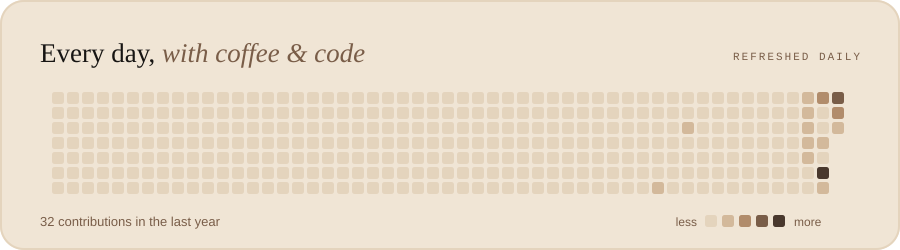

<table width="100%" border="0" cellpadding="0" cellspacing="0">
<tr>
<td width="72%" valign="middle">

</td>
<td width="28%" align="center" valign="middle">

</td>
</tr>
</table>

## About me

I'm a Software Development Engineering student who enjoys building useful web applications, working with APIs and learning how software can solve real problems. I value clean code, thoughtful design and continuous learning.

**Technologies:** Java · Python · JavaScript · TypeScript · React · Angular · Node.js · FastAPI · PostgreSQL · MySQL · MongoDB · Docker · Playwright · GitHub Actions

## Languages

| Language | Level |
|---|---|
| Spanish | Native |
| English | B2 |
| Portuguese | A1 |

## Education

**Software Development Engineering** — Universidad Católica de El Salvador (UNICAES).
