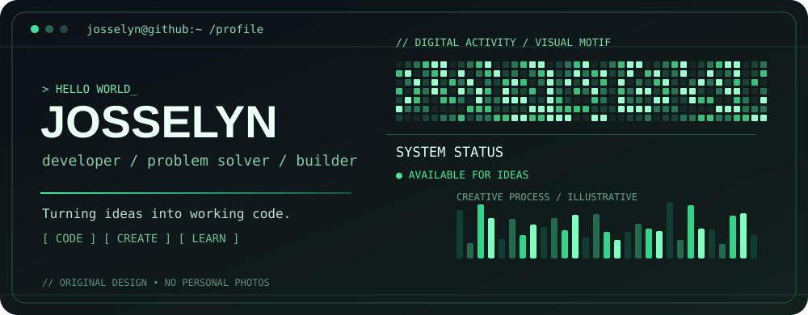

 

### Hi, I'm Josselyn 👋

**Building, experimenting and learning through code.**

`Software Development` · `Java` · `JavaScript` · `Databases` · `Open Source`

---

### `> about_me`

- 💻 I enjoy turning ideas into real applications.
- 🌱 Always learning and improving my skills.
- 🧩 I like solving problems and building useful tools.
- ✨ Interested in clean interfaces and good user experiences.

### `> tech_stack`

### `> github_activity`

### `> contribution_snake`

<!-- Appears after the GitHub Action runs successfully. -->

---

Designed with 💚 • Animated pixel art • Keep building

