<table width="100%" border="0" cellpadding="0" cellspacing="0">
<tr>
<td width="70%" valign="middle">

</td>
<td width="30%" align="center" valign="middle">

</td>
</tr>
</table>

## About me

Junior Software Engineer interested in building useful web applications, designing REST APIs and improving software quality through automated testing. I enjoy solving problems, learning new technologies and collaborating on open-source projects.

**Technologies:** Java · Python · JavaScript · TypeScript · React · Angular · Node.js · FastAPI · PostgreSQL · MySQL · MongoDB · Docker · Playwright · GitHub Actions

## Selected projects

- **[Apache Fineract](https://github.com/apache/fineract)** — Open-source contributions using Angular, TypeScript and Playwright. Added client group display, translations and unit/E2E tests; PR #884 under review.
- **GoBus — Route Planner** — React and Python/FastAPI prototype with interactive maps, Google ADK, MCP and a Node.js routing engine.
- **Progreso Musical** — Web application built with JavaScript, HTML and CSS to manage music assignments, grading rubrics and student progress.

## Languages

| Language | Level |
|---|---|
| Spanish | Native |
| English | B2 |
| Portuguese | A1 |

## Education

**B.S. in Software Development Engineering** — Universidad Católica de El Salvador (expected 2028).
