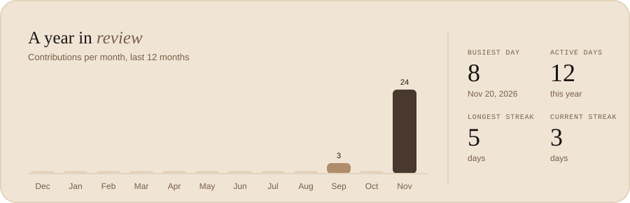
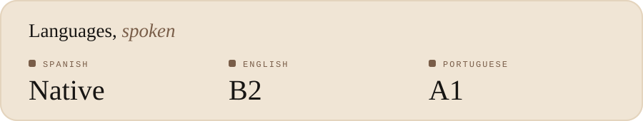

 

[github](https://github.com/josselyndimas)  /  [linkedin](https://www.linkedin.com/in/josselyndimas)  /  [email](mailto:josselyndimas552@gmail.com)

## About me

I'm a Junior Software Development Engineering who enjoys building useful web applications, working with APIs and learning how software can solve real problems. I value clean code, thoughtful design and continuous learning.

**Technologies:** Java · Python · JavaScript · TypeScript · React · Angular · Node.js · FastAPI · PostgreSQL · MySQL · MongoDB · Docker · Playwright · GitHub Actions

## Education

**Software Development Engineering** — Universidad Católica de El Salvador.
